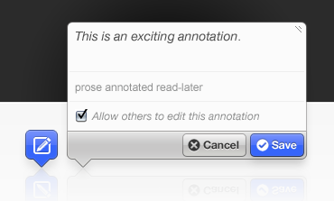
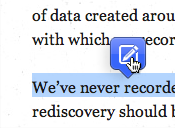
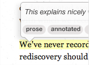
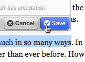
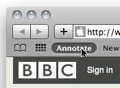

# Annotator

<section class="relative overflow-hidden rounded-3xl border border-stone-200 bg-gradient-to-br from-stone-950 via-slate-900 to-emerald-950 px-8 py-12 text-stone-50 shadow-2xl shadow-stone-950/20 md:px-12 md:py-16">
  

  

    

      

        Reboot In Progress
      

      <h1 class="max-w-4xl text-4xl font-black tracking-tight text-white md:text-6xl">
        The collaborative annotation layer for the open web.
      </h1>
      

        Annotator is an open-source JavaScript library for adding annotation functionality to web content: highlights, notes, metadata, storage, and shared discussion directly on top of documents.
      

      

        This project is being actively rebooted. The historical library, docs, and site content have been consolidated into one repository so the code, public site, and documentation can evolve together.
      

      

        <a class="inline-flex items-center justify-center rounded-full bg-emerald-400 px-5 py-3 text-sm font-semibold text-stone-950 transition hover:bg-emerald-300" href="../docs/index.md">Read the docs</a>
        <a class="inline-flex items-center justify-center rounded-full border border-stone-300/30 px-5 py-3 text-sm font-semibold text-stone-100 transition hover:border-stone-100 hover:bg-stone-100/10" href="showcase.md">See the showcase</a>
        <a class="inline-flex items-center justify-center rounded-full border border-stone-300/30 px-5 py-3 text-sm font-semibold text-stone-100 transition hover:border-stone-100 hover:bg-stone-100/10" href="https://github.com/openannotation/annotator">View the code</a>
      

    

    

      

      

        
      

    

  

</section>

  

    
What it does

    
Turn any web page into an annotatable surface with highlights, comments, metadata, and UI components for creating and viewing annotations.

  

  

    
How it works

    
Browser-side UI and selection logic combined with pluggable identity, authorization, and storage modules.

  

  

    
Why now

    
There are still not many mature open-source annotation stacks. Annotator remains a credible base for revival.

  

  

    
Project state

    
Modern local build restored, tests running in headless Chrome, docs and site consolidated into the main repository.

  

## Why Annotator Still Matters

  

    <h2 class="text-2xl font-bold tracking-tight text-stone-900">A library, not just a demo</h2>
    

      Annotator was used in real projects across education, publishing, research, and public knowledge. It was built around a clean separation between browser UI, annotation storage, and identity/authz concerns, which still makes architectural sense today.
    

    

      The reboot is not about preserving a relic. It is about recovering a serious open-source annotation system and putting it back on a maintainable footing.
    

  

  

    <figure class="overflow-hidden rounded-3xl border border-stone-200 bg-white shadow-sm">
      
      <figcaption class="px-4 py-3 text-sm text-stone-600">Select text to create an annotation.</figcaption>
    </figure>
    <figure class="overflow-hidden rounded-3xl border border-stone-200 bg-white shadow-sm">
      
      <figcaption class="px-4 py-3 text-sm text-stone-600">View annotations directly in context.</figcaption>
    </figure>
    <figure class="overflow-hidden rounded-3xl border border-stone-200 bg-white shadow-sm">
      
      <figcaption class="px-4 py-3 text-sm text-stone-600">Edit comment text and metadata.</figcaption>
    </figure>
    <figure class="overflow-hidden rounded-3xl border border-stone-200 bg-white shadow-sm">
      
      <figcaption class="px-4 py-3 text-sm text-stone-600">Historical reminder that Annotator aimed at the broader web, not only custom apps.</figcaption>
    </figure>
  

## Explore

  <a href="../docs/index.md" class="group rounded-3xl border border-stone-200 bg-white p-6 shadow-sm transition hover:-translate-y-1 hover:shadow-lg">
    
Documentation

    <h3 class="mt-3 text-xl font-bold text-stone-900">Technical docs</h3>
    
Installation, usage, modules, API reference, roadmap, and change history.

    
Open docs

  </a>
  <a href="showcase.md" class="group rounded-3xl border border-stone-200 bg-white p-6 shadow-sm transition hover:-translate-y-1 hover:shadow-lg">
    
Adoption

    <h3 class="mt-3 text-xl font-bold text-stone-900">Showcase</h3>
    
See projects and organizations that historically used Annotator in the wild.

    
View showcase

  </a>
  <a href="plugins.md" class="group rounded-3xl border border-stone-200 bg-white p-6 shadow-sm transition hover:-translate-y-1 hover:shadow-lg">
    
Ecosystem

    <h3 class="mt-3 text-xl font-bold text-stone-900">Plugins</h3>
    
Browse the historical plugin catalog for integrations, storage backends, and UI extensions.

    
Browse plugins

  </a>
  <a href="news/index.md" class="group rounded-3xl border border-stone-200 bg-white p-6 shadow-sm transition hover:-translate-y-1 hover:shadow-lg">
    
Archive

    <h3 class="mt-3 text-xl font-bold text-stone-900">News and notes</h3>
    
Historical community updates, call notes, and project conversations imported from the old site.

    
Read archive

  </a>

## Repository

  <h2 class="text-2xl font-bold tracking-tight text-white">One repository, one source of truth</h2>
  

    The library, public site content, and project documentation now live together. That makes it much easier to keep the technical story, public narrative, and reboot work in sync.
  

  

    <a class="inline-flex items-center justify-center rounded-full bg-white px-5 py-3 text-sm font-semibold text-stone-950 transition hover:bg-stone-200" href="https://github.com/openannotation/annotator">Source code</a>
    <a class="inline-flex items-center justify-center rounded-full border border-white/20 px-5 py-3 text-sm font-semibold text-white transition hover:bg-white/10" href="https://github.com/openannotation/annotator/releases">Releases</a>
  

