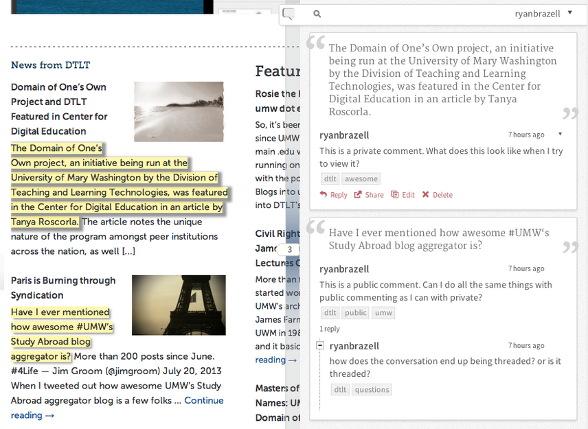
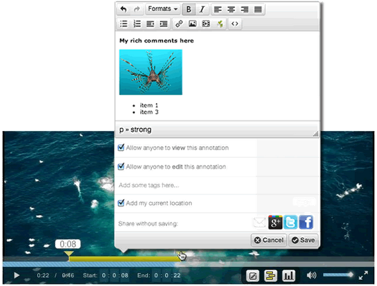
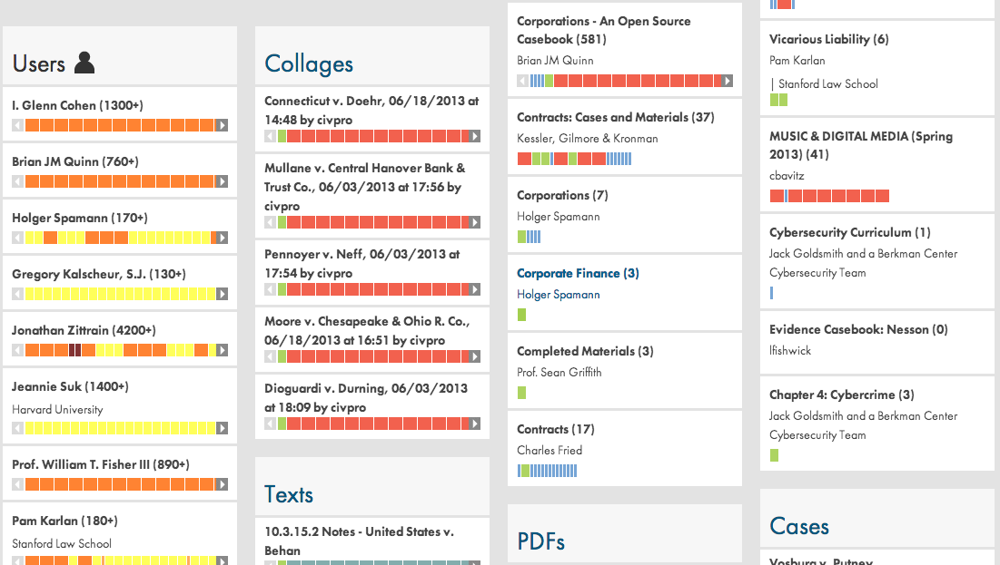
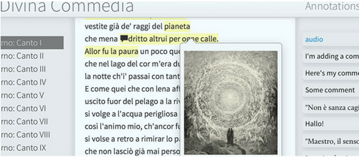
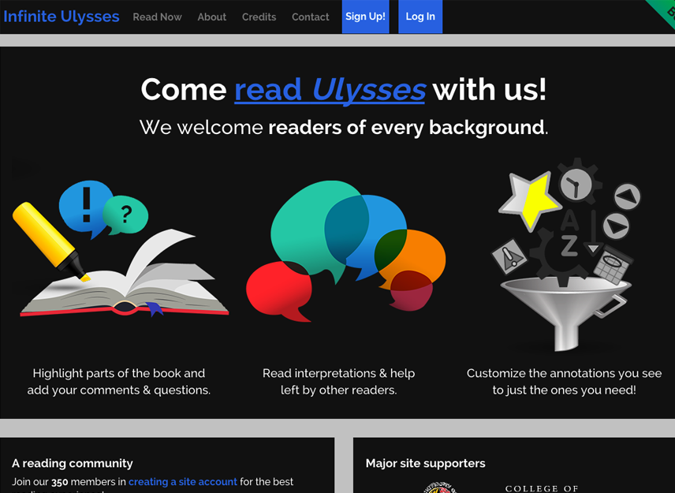
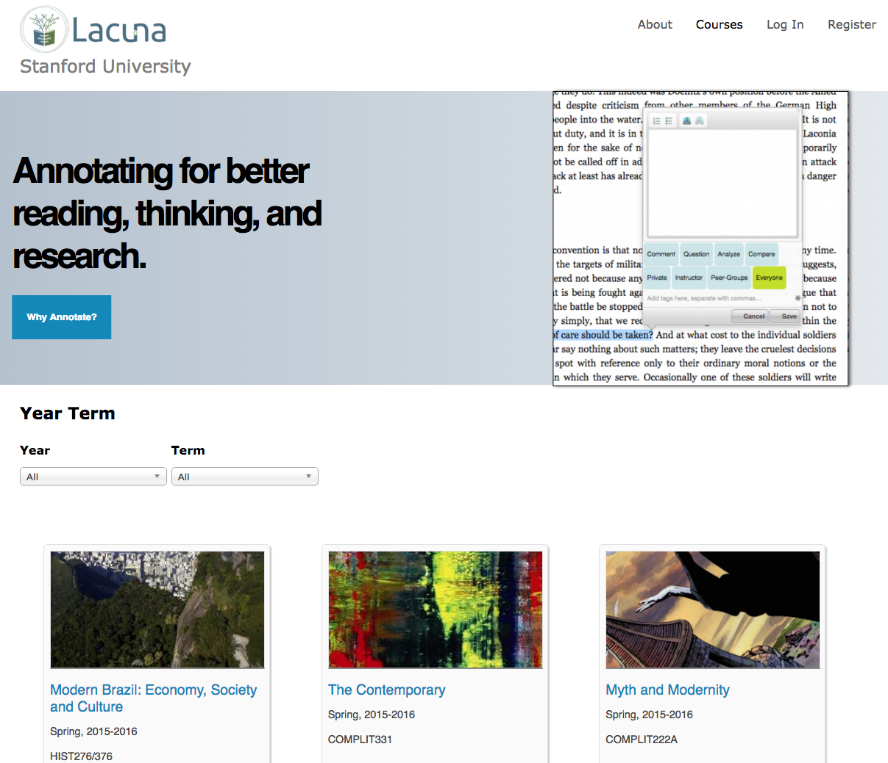

# Showcase

<section class="rounded-3xl border border-stone-200 bg-gradient-to-br from-white to-stone-100 px-8 py-10 shadow-sm">
  

    
Historical adoption

    <h1 class="mt-3 text-4xl font-black tracking-tight text-stone-950 md:text-5xl">Annotator was used in real projects across the web.</h1>
    

      This page is a cleaned-up version of the historical showcase from `annotatorjs.org`. It matters because it shows that Annotator was not just a demo widget. It powered work in education, research, publishing, public discourse, and collaborative reading.
    

  

</section>

  <article class="overflow-hidden rounded-3xl border border-stone-200 bg-white shadow-sm">
    
    

      <h2 class="text-2xl font-bold text-stone-950"><a href="http://hypothes.is">Hypothes.is</a></h2>
      
Used Annotator in its earlier history as part of building an open annotation platform for the web.

    

  </article>
  <article class="overflow-hidden rounded-3xl border border-stone-200 bg-white shadow-sm">
    
    

      <h2 class="text-2xl font-bold text-stone-950"><a href="http://openvideoannotation.org">Open Video Annotation Project</a></h2>
      
Applied Annotator-oriented ideas to media-rich commentary on fragments of video.

    

  </article>
  <article class="overflow-hidden rounded-3xl border border-stone-200 bg-white shadow-sm">
    
    

      <h2 class="text-2xl font-bold text-stone-950"><a href="http://h2o.law.harvard.edu">H2O</a></h2>
      
Used annotation in web-based casebooks and classroom tools from Harvard’s Berkman Center ecosystem.

    

  </article>
  <article class="overflow-hidden rounded-3xl border border-stone-200 bg-white shadow-sm">
    
    

      <h2 class="text-2xl font-bold text-stone-950"><a href="http://www.annotationstudio.org">Annotation Studio</a></h2>
      
Supported close reading and collaborative interpretation in teaching and humanities contexts.

    

  </article>
  <article class="overflow-hidden rounded-3xl border border-stone-200 bg-white shadow-sm">
    
    

      <h2 class="text-2xl font-bold text-stone-950"><a href="http://www.InfiniteUlysses.com">Infinite Ulysses</a></h2>
      
Built a public annotation and social reading layer around James Joyce’s <em>Ulysses</em>.

    

  </article>
  <article class="overflow-hidden rounded-3xl border border-stone-200 bg-white shadow-sm">
    
    

      <h2 class="text-2xl font-bold text-stone-950"><a href="http://www.lacunastories.com">Lacuna</a></h2>
      
Explored collaborative digital reading and annotation in learning and teaching environments.

    

  </article>

## More Historical Users

  

    <ul class="space-y-3 leading-7 text-stone-700">
      <li><a href="http://www.edx.org"><strong>edX</strong></a> used annotation in online learning contexts.</li>
      <li><a href="http://www.mpiwg-berlin.mpg.de"><strong>Max Planck Institute for the History of Science</strong></a> used annotation in research contexts.</li>
      <li><a href="http://oerpub.org"><strong>OERPUB</strong></a> worked on open education publishing and annotation-related workflows.</li>
      <li><a href="http://karmanotes.org"><strong>KarmaNotes</strong></a> used annotation around shared learning materials.</li>
      <li><a href="http://opengovfoundation.org/the-madison-project/"><strong>The Madison Project</strong></a> supported public discussion of government documents.</li>
      <li><a href="http://peerlibrary.org"><strong>PeerLibrary</strong></a> used collaborative annotation on academic publications.</li>
      <li><a href="http://www.safaritutorials.com"><strong>Safari Tutorials</strong></a> used annotation in training contexts.</li>
      <li><a href="http://papergrader.org"><strong>Paper Grader</strong></a> used annotation in grading workflows.</li>
    </ul>
  

  

    <ul class="space-y-3 leading-7 text-stone-700">
      <li><a href="http://www.siyavula.com"><strong>Siyavula</strong></a> used online textbooks and learning resources with annotation-related needs.</li>
      <li><a href="http://open-apps.uoc.edu/"><strong>Universitat Oberta de Catalunya</strong></a> maintained open applications and teaching tools around this ecosystem.</li>
      <li><strong>Writing and publishing tools</strong> used Annotator as a substrate for in-context discussion and commentary.</li>
      <li><strong>Research and digital humanities projects</strong> used it to support interpretation, discussion, and collaborative reading.</li>
    </ul>
  

## Why This Matters

  <h2 class="text-2xl font-bold tracking-tight text-emerald-950">Evidence of product reality</h2>
  

    The showcase is useful because it proves that Annotator had real-world adoption. It was used in projects that cared about education, publishing, public reasoning, and collaborative knowledge work. That history is one reason the current reboot effort is worth taking seriously.
  

